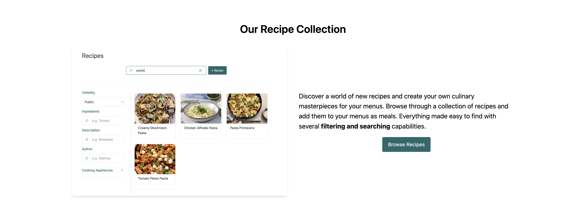
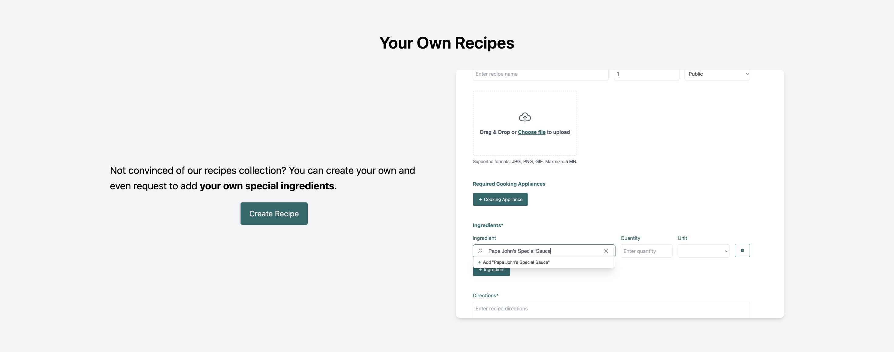
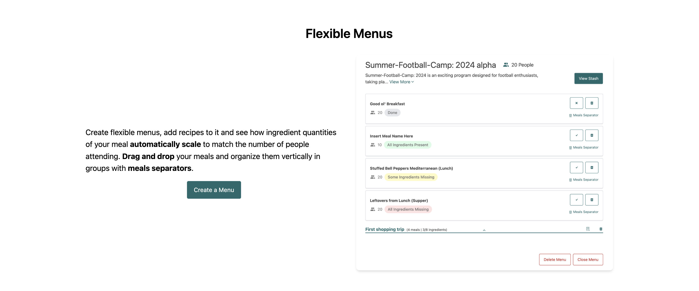
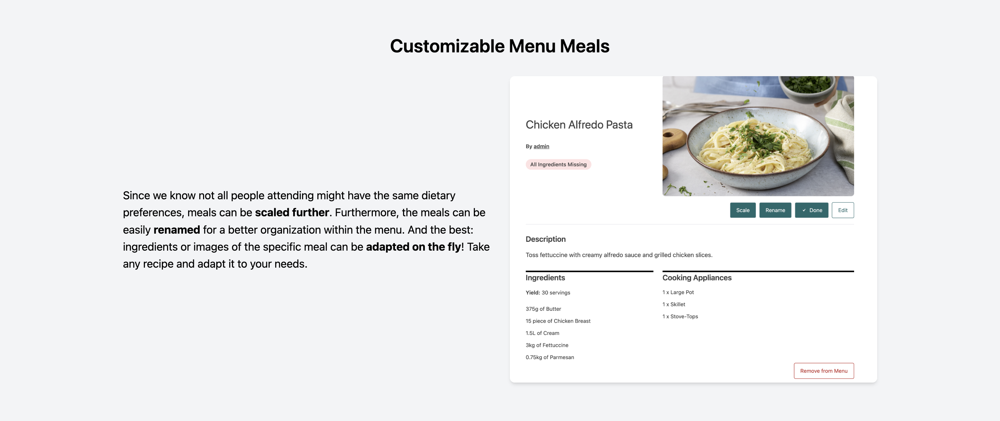
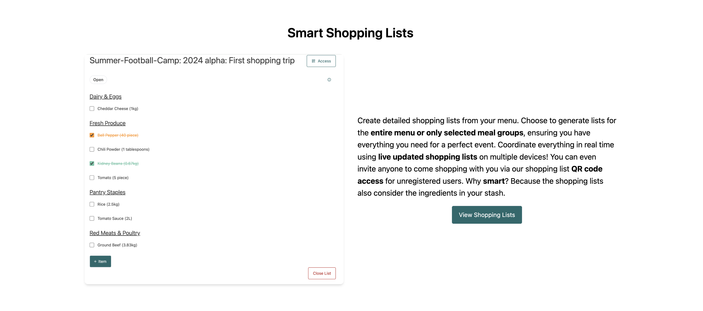
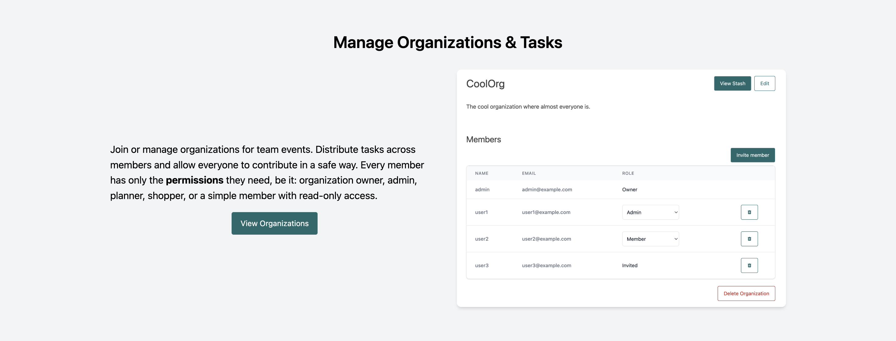
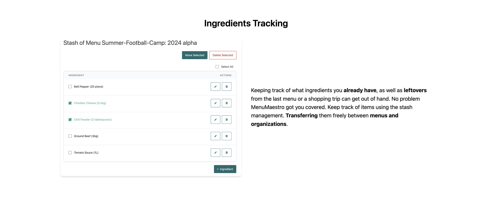

# MenuMaestro

### Plan together. Cook for everyone.

Planning meals for a group made easy! **MenuMaestro** helps you organize recipes, adjust portions, generate shopping lists, and keep track of ingredients — all in one place.

Built as a university team project, this full-stack web app helps groups organize meals and events with flexible menus, shared shopping lists, and live updates across devices. Its responsive interface adapts to desktop, tablet, and mobile screens, supporting both menu planning at a desk and shopping on the go.

See [Attribution](ATTRIBUTION.md) for project credits.

## A look inside















## Design process

Early Figma explorations of meal planning, recipe creation, and shared shopping. Click a preview to view the full design.

<p>
  <a href="docs/screenshots/figma/Meals%20for%20Event.png"></a>
  <a href="docs/screenshots/figma/Create%20Recipe.png"></a>
  <a href="docs/screenshots/figma/Shopping%20List.png"></a>
</p>

[Ingredient search](docs/screenshots/figma/Ingredients%20Search%20Items.png) · [Ingredient creation](docs/screenshots/figma/Create%20New%20Ingredient%20Dialog.png)

## Built with

| Layer | Technologies |
| --- | --- |
| Frontend | Angular 18, TypeScript, Tailwind CSS |
| Backend | Java 21, Spring Boot, Spring Security |
| Database | PostgreSQL |
| Collaboration & authentication | WebSockets, JWT |
| Local tooling | Maven, npm, Docker Compose |

## Run locally

### With Docker

Start Docker Desktop, then run from the project root:

```sh
docker compose up --build
```

Open **[localhost:4200](http://localhost:4200)** once the app finishes starting.
The backend runs at [localhost:8080](http://localhost:8080). Docker builds and
runs the frontend, backend, and PostgreSQL; no local Java, Maven, or Node.js
installation is required. The frontend uses Angular's development server for
this local demo. The first build needs internet access and takes longer while
dependencies download.

Press **Ctrl+C** to stop. To remove the containers while retaining the database
volume:

```sh
docker compose down
```

### Demo accounts

| Demo account | Password |
| --- | --- |
| `admin` | `hallo123` |
| `user1` through `user4` | `hallo123` |

### A few demo details

- Local app data resets when the backend starts.
- A new JWT secret is generated on startup, so sign in again after restarting.
- Email sending is disabled by default in this public portfolio version, and private SMTP credentials are excluded. The email implementation remains available, but password-reset emails and ingredient notifications are skipped until SMTP is configured and `EMAIL_ENABLED=true` is set.
- Included account and database credentials are for local development only.

### Deployment and QR sharing

This repository is set up as a local portfolio demo. The root Compose file runs
the frontend, backend, and database. Publishing the repository does not deploy
the app or provide a live backend.

Shopping-list QR codes contain the current page URL and a share token. When the
app runs on `localhost`, the generated link works on the same computer; scanning
it on a phone points to the phone's own `localhost`, so it cannot reach the app.
Sharing across devices requires a reachable deployment or a configured local
network setup, including frontend/backend URLs, CORS, and WebSocket origins.
Changing only the QR link to a local IP address is not sufficient with the
current configuration. Share tokens also become invalid when the backend
restarts with a new JWT secret.
